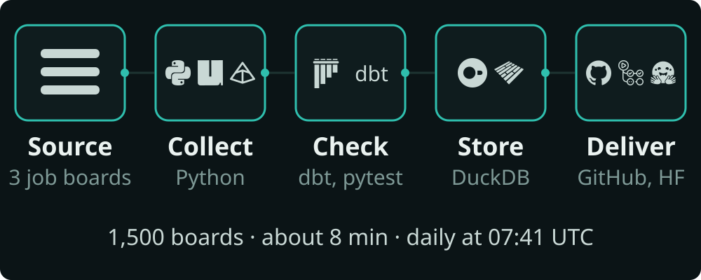
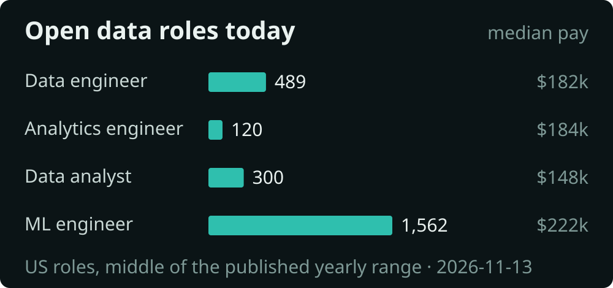
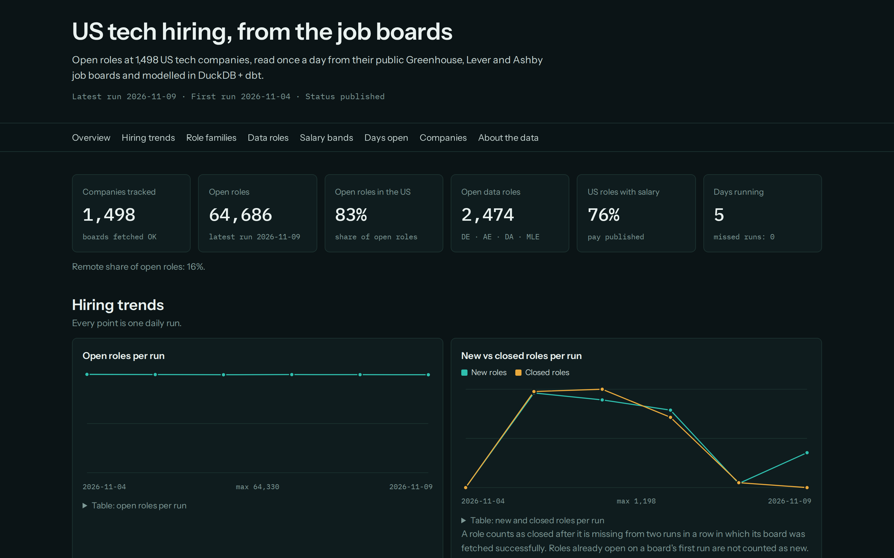
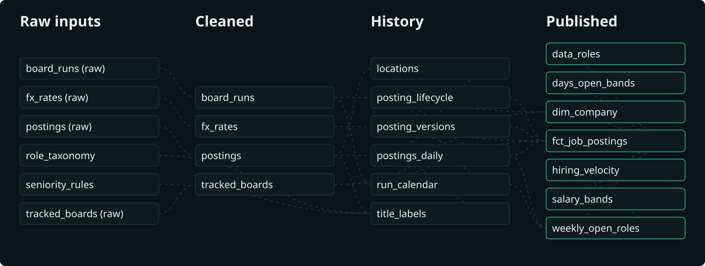

# US tech hiring data, checked every day

Every open job at 1,500 US tech companies, collected each morning from their public job boards and delivered as one clean table you can download, filter and chart.

[](public/runs.jsonl) [](public/status.json) [](public/status.json) [](public/summary/providers.csv) [](https://github.com/siddharthkumarx/job-postings-pipeline/actions/workflows/ci.yml)

**[Live dashboard](https://siddharthkumar.com/job-postings-pipeline/)** · **[Download the data](https://github.com/siddharthkumarx/job-postings-pipeline/releases/latest)**

## What you get

One row per open job: company, job title, location, remote or on-site, salary range when the company publishes one, the date it was first seen and a link to the original posting. Here are 5 real rows from the run of 2026-11-06:

| Company | Job title | Location | Work type | Salary (per year) | First seen |
|---|---|---|---|---|---|
| SpaceX | [Sr. AI Engineer, Supercomputing, Special Progra…](https://boards.greenhouse.io/spacex/jobs/8865268002?gh_jid=8865268002) | Hawthorne, CA | On-site | $220,000 to $350,000 | 2026-11-04 |
| Anduril Industries | [Senior Machine Learning Engineer (Applied Intel…](https://boards.greenhouse.io/andurilindustries/jobs/5250787007?gh_jid=5250787007) | Santa Ana, CA | On-site | $220,000 to $292,000 | 2026-11-04 |
| Databricks | [AI Engineer – Forward Deployed Engineering (AI…](https://databricks.com/company/careers/open-positions/job?gh_jid=8760167002) | MD | Not stated | $182,000 to $250,208 | 2026-11-04 |
| OpenAI | [Machine Learning Engineer, Monetization AI/ML](https://jobs.ashbyhq.com/openai/80f9f564-d789-47bc-91c3-3babf5a1a33d) | San Francisco, CA | On-site | $381,000 to $555,000 | 2026-11-04 |
| Accenture Federal Services | [Data Engineer Team Lead](https://boards.greenhouse.io/accenturefederalservices/jobs/4611519006?gh_jid=4611519006) | Arlington, VA | On-site | $160,700 to $306,500 | 2026-11-04 |

The full table has 65,378 rows today. The download includes every field listed in the [data dictionary](#data-dictionary).

### What changed today

Compared with the run of 2026-11-05:

- **1,068 new roles** opened, most at Anduril Industries (42), SpaceX (32), Samsara (30).
- **0 roles closed**.
- **258 salary ranges** and **238 job titles** were edited by the companies.

## Why you can trust this data

- **Checked against a second source.** Every run re-reads 30 random jobs one by one from a second official address at the job board and compares the title and location. Latest run (2026-11-06): 30 of 30 matched.
- **Doubtful values are held back, not guessed.** In the latest run, 87 salary figures that looked wrong (far outside any normal yearly pay once converted) were left empty instead of published, and 12 malformed job ads were set aside. If a whole run looks wrong, it is not published at all and yesterday's data stays up until it is fixed.
- **Nothing missing.** 1,499 of 1,500 company job boards were read in the latest run. A job only counts as closed after it is missing on two days in a row, so one bad day cannot wipe out real openings.
- **Polite collection.** One request per company per day, plus the 30 spot checks (1,530 requests in the latest run), a short pause between requests, no logins, and only the official public job-board feeds that the companies use for their own career pages.
- **Tested every day.** The latest run passed all 91 automatic data checks. Missed or held days are counted in public: see the badges above and the [run log](public/runs.jsonl).

## How it works



1. **Collect.** Each morning at 07:41 UTC, the pipeline reads the public job board of every tracked company: 779 on Greenhouse, 669 on Ashby and 52 on Lever.
2. **Check.** Every job is cleaned and tested. Titles become role types (for example "data engineer"), locations become city and state, and salaries become yearly US dollars.
3. **Store.** Each day's raw data is kept, so history (when a job opened, when it closed, when its salary changed) can always be rebuilt.
4. **Deliver.** The clean table, the [dashboard](https://siddharthkumar.com/job-postings-pipeline/) and a monthly download are refreshed. A full run takes about 9 minutes.





## What broke and how I fixed it

Every pipeline breaks sometimes. What matters is that problems are caught before bad data reaches you, fixed quickly and written down. Real incidents from the [incident log](docs/incidents.md):



- **2026-11-04: A saved copy of the database was missing a table.** The nightly saved copy of the database was taken a moment too early, so it could miss the newest changes. Every copy is now completed and checked before it is saved. A bad copy is never used; the data is rebuilt from the raw daily files instead.
- **2026-11-04: Locations made only of dashes stopped the data model.** A few job ads gave their location as just a dash. The step that reads locations did not expect that, so the run was held back and nothing wrong was published. Empty locations are now handled. The same day's data was re-processed and published.
- **2026-11-04: An odd salary format stopped the first run.** One job ad wrote its salary as "140.000.00". The salary reader did not expect that format and stopped the whole first run. It now reads that format. One odd ad can only skip itself and can never stop a run again. A test guards it.
- **2026-11-03: The public web archive used to find companies was overloaded.** The public web archive used to find company job boards was overloaded, and many of its pages timed out. The collector waited and retried politely. It still found 9,904 candidate boards, and 1,500 companies were kept after checks.
- **2026-11-03: One slow answer from the web archive.** One request to the public web archive timed out once. It was retried after a pause; nothing was lost.

## Who uses data like this

- **Recruiters and staffing teams** see which companies are hiring for which roles, and where, before they make a call.
- **HR-tech and people-analytics teams** plug the daily table into their own products and track open roles, time-to-fill and salary ranges over time.
- **Analysts and data hiring managers** compare pay and demand for data engineers, analytics engineers, data analysts and ML engineers across 1,500 companies.

## Want this for your own sites?

I build and run pipelines like this one for clients: job boards, competitor career pages, marketplaces, price lists and other public data.

- **Free sample first.** You get 20 to 50 real rows from your own target sites before you pay anything.
- **Fixed price.** A clear quote after the sample, with no hourly surprises.
- **Data on schedule.** Daily, weekly or one-off, delivered as CSV, Excel, Google Sheets or straight into your database.

**Contact:** [hello@siddharthkumar.com](mailto:hello@siddharthkumar.com) · [siddharthkumar.com](https://siddharthkumar.com)

## FAQ

**How fresh is the data?**
It is collected every morning at 07:41 UTC. The latest run was on 2026-11-06. The badges at the top always show the last run and any missed days.

**What happens when a site changes?**
The daily checks notice it, that day's data is held back instead of published, and I get an alert. I fix the collector, usually the same day, and the incident goes in the public log above.

**Which formats can I get?**
CSV, Excel, Google Sheets, JSON, Parquet (a compact file format that data tools read quickly), or a direct load into your database. This project publishes CSV summaries and a monthly Parquet file.

**Can you track my competitors' sites?**
Yes, if the information is publicly visible without logging in. Send me the list of sites and I will check what is possible and send a free sample.

**Is it legal and polite?**
This project reads only public pages and official public feeds, follows each site's published rate limits, collects no personal data and links back to every original posting. See [Data use and compliance](#data-use-and-compliance).

**How does pricing work?**
Either a fixed monthly price for a running pipeline or a one-time price for a single delivery. You get a quote after the free sample, once both of us know exactly what the data looks like.

## Data dictionary

One row per job posting ever seen. The examples are real values from the run of 2026-11-06.

| Field | Type | Meaning | Example |
|---|---|---|---|
| `posting_key` | text | Unique ID of the job posting in this dataset | `00153e9e9c93…` |
| `provider` | text | Job-board software the company uses: Greenhouse, Lever or Ashby | greenhouse |
| `board` | text | The company's board name on that job board | spacex |
| `company_id` | text | Unique ID of the company in this dataset | `c12f2c997835…` |
| `company_name` | text | Company name | SpaceX |
| `posting_id` | text | The job board's own ID for the posting | 8579126002 |
| `title` | text | Job title as the company wrote it | Sr. Software Engineer, High Performance Computi… |
| `role_family` | text | Role type worked out from the title (e.g. data engineer) | software_engineer |
| `seniority` | text | Level worked out from the title (intern to VP) | senior |
| `seniority_source` | text | Where the level came from: the title, the job ad text, or a default | title |
| `department` | text | Department or team as published | Starlink Network Engineering |
| `location_raw` | text | Main location as the company wrote it | Palo Alto, CA |
| `country_code` | text | Country code (US, GB …); empty if unknown | US |
| `state_code` | text | US state code, for US jobs | CA |
| `city` | text | City, when it can be read from the location | Palo Alto |
| `remote_type` | text | Remote, hybrid, on-site, or not stated | onsite |
| `employment_type` | text | Full-time, part-time, contract, internship, temporary, or not stated | unknown |
| `salary_min` | number | Lowest salary as published, in its own currency and period | 175000 |
| `salary_max` | number | Highest salary as published | 240000 |
| `salary_currency` | text | Currency of the published salary | USD |
| `salary_period` | text | Whether the published salary is per year, month, week, day or hour | year |
| `salary_min_annual` | number | Lowest salary converted to a yearly amount | 175000 |
| `salary_max_annual` | number | Highest salary converted to a yearly amount | 240000 |
| `salary_min_usd_annual` | number | Lowest yearly salary in US dollars | 175000 |
| `salary_max_usd_annual` | number | Highest yearly salary in US dollars | 240000 |
| `salary_source` | text | Where the salary came from: the job board's salary field or the ad text | description |
| `fx_rate_date` | date | Date of the official exchange rate used for the dollar conversion | 2026-11-04 |
| `job_url` | text | Link to the original posting | [link](https://boards.greenhouse.io/spacex/jobs/8579126002?gh_jid=8579126002) |
| `published_at` | date and time (UTC) | When the company published or last updated the posting | 2026-06-09 21:04:05+00:00 |
| `first_seen` | date | First day the job was seen | 2026-11-04 |
| `last_seen` | date | Last day the job was seen | 2026-11-06 |
| `closed_on` | date | Day the job was counted as closed (missing two days in a row) | empty while the job is open |
| `is_open` | yes / no | Whether the job was open in the latest run | true |
| `days_open` | whole number | Days the job has been open so far, or was open in total | 3 |
| `left_censored` | yes / no | Yes if the job was already open on the first day it was tracked | true |
| `version_count` | whole number | How many times the title, location or salary changed, plus one | 1 |
| `taxonomy_version` | text | Version of the rules used for role type and level | 2026-11-03 |

<details>
<summary><b>For engineers</b></summary>

### Architecture

Daily GitHub Actions run → polite async collector (httpx, per-host limits, retries only on 429/5xx, Retry-After honoured, a block stops that host) → one Pydantic record per posting, with free text dropped → **bronze** Parquet per run date, stored as GitHub Release assets → **dbt-duckdb**: silver (staging) → history (lifecycle, SCD2) → gold marts with enforced contracts → quality gates (dbt tests, row-count and null-rate guards) → publish or hold → summary CSVs, monthly dataset, `status.json` badges, static dashboard and this README, re-rendered every run. Details: [docs/architecture.md](docs/architecture.md).



### Data model

| Layer | Models | Notes |
|---|---|---|
| Bronze | `postings`, `board_runs`, `fx` Parquet per run date | API fields minus free text and personal fields; descriptions are read in memory only for salary, remote and seniority hints, plus a SHA-256 |
| Silver | `stg_postings`, `stg_board_runs`, `stg_fx_rates`, `stg_tracked_boards` | incremental, delete+insert by run date (idempotent) |
| History | `int_postings_daily`, `int_posting_lifecycle`, `int_posting_versions`, `int_title_labels`, `int_locations` | first/last seen, closed after 2 missed successful fetches, SCD2 on title/location/salary, versioned role taxonomy |
| Gold | `fct_job_postings`, `dim_company`, `mart_weekly_open_roles`, `mart_days_open_bands`, `mart_salary_bands`, `mart_hiring_velocity`, `mart_data_roles` | dbt contracts enforced; schema in [docs/data-contracts.md](docs/data-contracts.md) |

### Repository layout

```
src/jobpipe/        collector, models, state, guards, publish, dashboard, visuals, README renderer
dbt/                dbt project (staging, intermediate, marts, seeds, tests)
seeds/boards.csv    the 1,500 tracked boards (how they were chosen: docs/sources.md)
public/             run log, status.json, badges and summary CSVs (committed by every run)
templates/          README and dataset-card templates
checks/             live checks run on GitHub Actions and their results
tests/              pytest, golden fixtures from real boards
docs/               decisions, contracts, sources, incidents, architecture
```

### Run it locally

```bash
git clone https://github.com/siddharthkumarx/job-postings-pipeline.git && cd job-postings-pipeline
uv sync
uv run pytest
uv run jobpipe fixtures-build --dir data/fixtures
uv run jobpipe site --duckdb data/fixtures/warehouse.duckdb --public data/fixtures/public --out site
```

`jobpipe fixtures-build` runs the full dbt project on synthetic data, offline. A live run (`uv run jobpipe run`) needs network access and a `GITHUB_TOKEN` with `contents: write`, because state is stored in Release assets. `jobpipe backfill --from A --to B` replays stored snapshots, and `jobpipe rebuild` rebuilds the warehouse from every snapshot.

### Tests and CI

`ruff`, `mypy --strict`, `pytest` (unit tests, golden fixtures from 5 real boards, end-to-end runs against a fake GitHub API), a dbt build with 91 data tests on synthetic data, `pip-audit`, `gitleaks`, an internal link check, a 50 MB file guard and a commit-message check. Workflows: [ci.yml](.github/workflows/ci.yml), [daily.yml](.github/workflows/daily.yml), [checks.yml](.github/workflows/checks.yml).

### Key decisions

- [Sources, terms and politeness](docs/decisions.md#d-001-sources-official-public-job-board-apis-only-checked-2026-11-03): official public job-board APIs only; Lever at ≤ 1 request/s.
- [Where state lives](docs/decisions.md#d-007-where-state-lives-github-release-assets): GitHub Release assets, with the warehouse rebuildable from bronze.
- [Lifecycle definitions](docs/decisions.md#d-011-lifecycle-definitions) and [quality gates](docs/decisions.md#d-012-quality-gates-and-holds).
- [How the 1,500 companies were chosen](docs/sources.md) and [run-time budget](docs/decisions.md#d-009-daily-run-time-budget--45-min-lever-at-1-requests).

</details>

## Data use and compliance

- Only public job-board pages and the official public job-board APIs of Greenhouse, Lever and Ashby are used. No logins, no paywalls.
- `robots.txt` and rate limits are respected: at most one request per company per day, a pause between requests, and Lever at no more than one request per second as its `robots.txt` asks.
- No personal data: recruiter or hiring-manager names, emails and phone numbers are never collected or stored.
- No job descriptions or images are republished. Descriptions are read once, in memory, only to find the salary and remote hints, and are then discarded. Every row links back to the original posting.
- **Opt-out:** email [hello@siddharthkumar.com](mailto:hello@siddharthkumar.com) and your company's postings are removed within 24 hours.

## License

The code is released under the [MIT License](LICENSE). The published dataset is factual job metadata compiled from public postings, shared under [CC BY 4.0](https://creativecommons.org/licenses/by/4.0/). Each posting belongs to the company that published it and is linked at its source. Citation details are in [CITATION.cff](CITATION.cff); the dataset card is in [docs/dataset-card.md](docs/dataset-card.md).

Built and maintained by Siddharth Kumar · [siddharthkumar.com](https://siddharthkumar.com)
